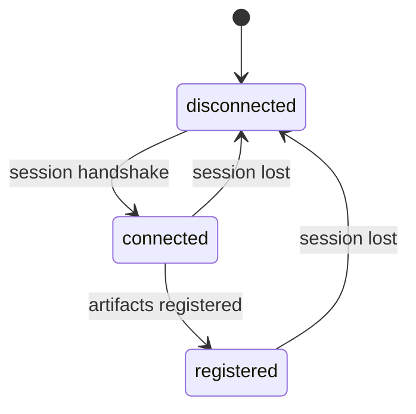

A Chronicle client is a small supervision tree whose processes depend on one live connection to the kernel. Reactors, reducers, projections, seeders, webhooks and subscriptions need that connection to come back after it drops. The client drives them through one connection lifecycle rather than letting each retry independently and race to register observers before the kernel knows their definitions. The design follows the .NET client's connection lifecycle.

For your application, the first distinction is between a channel that can carry calls and a client that has finished registering. Use that distinction when waiting for startup, then inspect registration if the client does not become ready.

## The three phases

| Phase | Meaning |
|-------|---------|
| `:disconnected` | No live session with the kernel. |
| `:connected` | The session handshake completed: the kernel acknowledged the client's connection id with its first keepalive. The channel can carry calls. |
| `:registered` | The client has registered the event store, namespace, event types, constraints, read models and projections. Observers may now attach, and seeders run. |

Splitting `:connected` from `:registered` keeps observers from racing ahead of their server-side definitions. A reducer's observation stream can't be registered until the kernel knows about the reducer's read model, so reactors and reducers wait for `:registered`, never merely `:connected`.



## Wait for readiness in your code

`Chronicle.Client` starts, and returns from `Supervisor.start_link/2`, long before the lifecycle reaches `:registered`. What a call does in that window depends on the call:

- Appends, event log reads and most other calls use the gRPC channel as soon as it exists. Before that, and while the client reconnects, they return `{:error, :not_connected}` instead of waiting. Once the channel is up they are sent even if registration hasn't finished, so an append can reach the kernel before your event types are registered.
- Read model queries in `Chronicle.ReadModels`, including `Chronicle.read_model/3`, first wait up to 30 seconds for `:registered`, then retry briefly while the kernel settles.

Block until the client is ready with `Chronicle.Connections.Lifecycle.wait_until/3`:

```elixir
alias Chronicle.Connections.Lifecycle

case Lifecycle.wait_until(Lifecycle.name_for(Chronicle.Client), :registered, 30_000) do
  :ok -> :ready
  {:error, :timeout} -> :not_ready
end
```

`Lifecycle.name_for/1` takes the client's `name:`, which defaults to `Chronicle.Client`. To follow phase changes instead of blocking, call `Lifecycle.subscribe/1`. It returns `{:ok, phase, connection_id}` with the current phase and then sends `{:chronicle_lifecycle, phase, connection_id}` messages on every transition. `Lifecycle.phase/1` returns the current phase.

## What happens on connect

On every connection, including after a reconnect, the client runs the same ordered registration:

1. Ensure the event store and namespace exist.
2. Register event types, including their migrations.
3. Register constraints.
4. Register read models.
5. Register projections, including the read-model definitions of reducers.
6. Advance to `:registered`.
7. Reactors and reducers open their observation streams, webhook and subscription registrars register, and seeders run.

Steps 1 to 5 finish before step 7, so observers never register against definitions that don't exist yet. If a registration step fails, the client logs `Chronicle registration failed` with the reason and stays in `:connected`. Retryable failures use a five-second delay by default; permanent rejections are not retried. A rejected event type schema can therefore leave the client short of `:registered` rather than retrying indefinitely. Check the log for the reason, then inspect registration as described below.

## Awaiting and inspecting registration

Use the registration methods to wait for completion or inspect why it has not finished:

```elixir
:ok = Chronicle.Client.await_registration()                       # waits up to 30 seconds
{:error, {:failed, status}} = Chronicle.Client.await_registration()  # the kernel rejected something for good
%{state: :registering, attempts: 2, error: error, next_retry_in: ms} = Chronicle.Client.registration_status()
```

`registration_status/1` reports `:pending`, `:registering`, `:registered` or `:failed`. A rejection the kernel will never accept — a validation failure, an invalid argument — is `:failed` at once and is not retried. Retryable failures use backoff, but retrying also stops when a configured attempt limit is reached. Tune it with the client's `:registration` option:

```elixir
{Chronicle.Client,
 registration: [initial_delay: 1_000, max_delay: 30_000, multiplier: 2, jitter: 0.2, max_attempts: 10]}
```

The default keeps the fixed five-second delay with no attempt limit for retryable failures. Permanent failures still stop registration.

## Watchdog

For a client that stays short of `:registered`, the watchdog reconnects it after the configured interval:

```elixir
{Chronicle.Client, watchdog: [unregistered_for: 60_000]}
```

The default is 60 seconds when enabled with `watchdog: true`. This replaces a hand-written supervisor-of-the-client watchdog.

## What happens on disconnect

The kernel sends the client a keepalive every second, and the client answers each one. When no keepalive arrives for five seconds, or the session stream ends, the client treats the session as dead:

1. The lifecycle moves to `:disconnected`.
2. Reactors and reducers close their observation streams and wait.
3. The connection id is rotated, so the next session uses a fresh identity.
4. The client dials a fresh channel and runs the connect sequence above again.

The channel reconnects with exponential backoff, starting at one second and capped at ten. Tune it with the `:reconnect_base_delay` and `:reconnect_max_delay` client options, in milliseconds. The client keeps retrying for as long as it runs.

The `:retry_attempts` option is accepted for backward compatibility and ignored; reconnection doesn't give up.

The session itself waits before connecting again, too. The first wait is at most one second, and each session that fails to connect or drops again straight away doubles that ceiling, up to thirty seconds, as in the .NET client. Every wait lands at random in the upper half of its ceiling, so clients that a kernel restart dropped together don't come back together. The wait starts over once a session stayed up for thirty seconds.

The session runs on its own HTTP/2 connection to the same server as everything else. The gRPC transport queues outgoing data for a connection in one queue. On a shared connection, a large reactor or reducer result waiting on flow control would also hold back the keepalive answers. On its own connection the session stays alive while observers work through large batches. To use one connection for everything, set `dedicated_session_channel: false`.

The five seconds match the kernel's `connectedClients.staleThresholdSeconds`. To tolerate longer gaps, raise the kernel setting and the client's `:keepalive_timeout` option (in milliseconds) together.

Reactors register as replayable, and projections and reducers are rewindable. When an observer re-attaches, Chronicle resumes it from the last event it handled, so events appended while it was detached are delivered then, not skipped.

## Calls during an outage

Appends and queries are not queued or retried while the client is disconnected. Treat them like any other remote call:

- Expect `{:error, :not_connected}` while the client has no channel, and decide whether to retry, fail the request, or wait with `Lifecycle.wait_until/3`.
- A call that races a dying channel returns `{:error, %GRPC.RPCError{status: 14}}` (unavailable). A reply the gRPC transport can't read, such as the kernel rejecting an unauthenticated call, returns `{:error, %GRPC.RPCError{status: 13}}`. Version 3.5.0 raised or exited in the caller in both cases.
- A successful `:ok` means Chronicle stored the event. An error from a call that timed out doesn't prove the write failed; see [Event sequences](../event-sequences.md#appending-and-waiting-for-observer-completion).

## Expired and rotated tokens

The client attaches a fresh bearer token to every call and refreshes it ahead of expiry. If the kernel answers a call with `Unauthenticated` — it restarted with new signing keys, say — the client drops its cached token and repeats that call once with a new one, instead of presenting the rejected token until it expires. Every reconnect also starts from a fresh token.

## Seeding waits for registration

Seeders run each time the lifecycle reaches `:registered`: at startup and again after every reconnect. A failed seeding run is retried every five seconds. The kernel remembers which seed entries it applied, so running it again after a reconnect applies nothing new. See [Seeding](../seeding.md#how-it-runs).

## Failure isolation

A failed observation stream is a different problem from losing the client's session. Each reactor and reducer manages its own observation stream. If one stream fails while the connection is healthy, only that stream reopens, after a short delay.

The delay grows while a stream keeps ending without having worked. The first wait is at most two seconds, and each stream that ends without having worked doubles that ceiling, up to a minute. Every wait lands at random in the upper half of its ceiling, so many observers that fail together during a kernel rollout come back at different times instead of as one herd. The wait starts over at two seconds once a stream delivered something or stayed open for three minutes. The three minutes are longer than the kernel takes to give up establishing a stream against a busy observer, so slow subscribes keep backing off. The defaults match the .NET client. Tune them with the `:observation_reconnect` client option, in milliseconds:

```elixir
{Chronicle.Client,
 connection_string: Chronicle.Connections.ConnectionString.development(),
 event_store: "my-store",
 otp_app: :my_app,
 observation_reconnect: [base_delay: 2_000, max_delay: 60_000, healthy_stream_duration: 180_000]}
```

A `base_delay` of `0` reopens a stream at once, without backing off.

A stream can also end because the kernel no longer knows the client's connection id, which happens when the kernel restarted and lost the session. Reopening the stream with the same connection id can never work, so the reactor or reducer asks for a full reconnect instead. The client drops the session as described in [What happens on disconnect](#what-happens-on-disconnect): the lifecycle moves to `:disconnected`, the connection id is rotated, and every reactor and reducer registers again once the new session reaches `:registered`. The session drops once, however many observers report the lost session.

Failing to send a result, for example because the connection is too busy to accept it in time, counts as a stream failure: the handler logs it, emits `[:chronicle, :observer, :result, :send_failed]` telemetry and reopens its stream, and Chronicle redelivers the events. A failing observer never takes down the connection or its siblings. Failures inside your handlers are reported to Chronicle as [failed partitions](../failed-partitions.md).

## Silent observers

Check observer progress separately from whether appends succeed. A kernel can evict a client's connection while appends keep working: observers stop receiving events and nothing fails. Watch their [lag](../observers.md#lag) with `observer_lag: [interval: 15_000]` and the `[:chronicle, :observer, :lag]` telemetry event.

## What you manage

You don't write reconnect code. The client re-establishes the session, re-registers artifacts and re-attaches observers on its own. What you do own is how your code behaves while the client is not `:registered`: wait for readiness before the first call, and handle `{:error, reason}` from every call.
